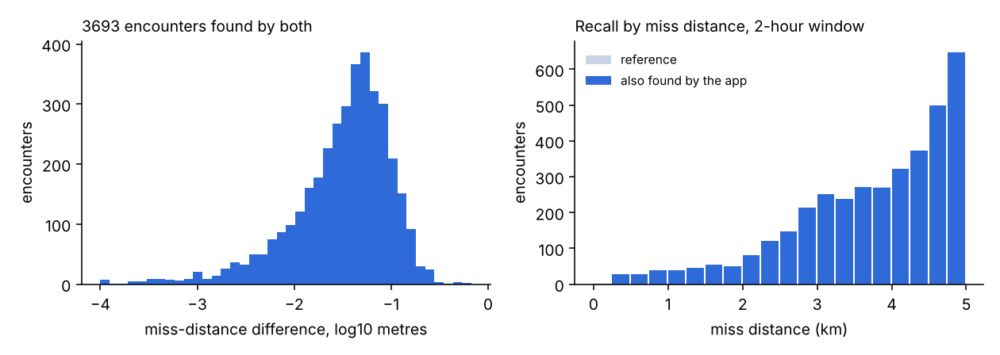

# validation

two things decide if a conjunction screener can be trusted: are the orbits propagated right, and does the screen catch every close approach that's actually there? both checked against independent references. everything re-runs from `bench/`.

## 1. propagation: satellite.js vs vallado's SGP4 verification set

the app propagates with [satellite.js](https://github.com/shashwatak/satellite-js). ran it on the official SGP4 verification cases from vallado, crawford, hujsak & kelso, *revisiting spacetrack report #3* (AIAA 2006-6753): the 33 test sats in `SGP4-VER.TLE` (near-earth, deep-space, resonant, high-eccentricity, decaying) compared state by state against the reference output `tcppver.out`.

| | result |
|---|---|
| reference states compared | 666 |
| worst position error | 0.12 mm |
| worst velocity error | 0.0009 mm/s |
| states not produced | 1 (sat 33334, built on purpose to trigger SGP4 error code 2, the reference only prints its epoch state) |

```bash
node bench/sgp4_vectors.js <folder with SGP4-VER.TLE and tcppver.out>
```
both files ship with the python `sgp4` package (`pip install sgp4`).

## 2. screening: the app's sieve vs an independent brute force screen

the app finds close approaches with a spatial-hash sieve at 20s steps, then refines each candidate with golden-section search. the reference shares none of that:

- **propagator:** python-sgp4 (vallado's C++ SGP4 compiled for python) instead of satellite.js
- **search:** every 5s (4× finer), a k-d tree pulls all pairs within 45 km. linear motion over half a step picks candidates, each refined with brent's method on true SGP4 distance

both screened the full catalogue (18,524 objects) over the same 2 hours from 2026-11-19 17:30 UTC, passes under 5 km. formation pairs (relative speed < 0.1 km/s, like docked spacecraft) skipped by both.

| | result |
|---|---|
| close approaches found by the reference | 3,718 |
| found by the app (recall) | 3,712 (99.84%) |
| recall under 1 km | 94 / 94 |
| miss distance, same encounter (3,693 pairs) | median diff 4 cm, worst 68 cm |
| time of closest approach | median diff 1 ms |
| app screening time, 2h of the full catalogue | 40s in node, one core |

**the 6 misses** are all 3.5 to 4.7 km. they come from two slow-crossing pairs that pass each other several times within a few seconds, the sieve merges those repeated minima into one event.

**the 10 app events the reference doesn't list** aren't false alarms:
- 9 have closest approach within 11s of the window edge. the app refines up to one step past the window, the reference stops at it
- 1 is exactly 5.000 km, right on the threshold



```bash
NODE_PATH=... T0=2026-11-19T17:30:00Z node tools/screen-catalog.js 2 bench/out/ours_2h.json 5
python3 bench/screen_ref.py cat.json 2026-11-19T17:30:00Z 2 5 bench/out/ref_2h.json
python3 bench/compare_screen.py bench/out/ours_2h.json bench/out/ref_2h.json
```

## 3. vs a live operational product: celestrak SOCRATES (daily, on github)

`.github/workflows/daily.yml` runs every day on github's servers:
1. downloads the current catalogue from celestrak (~30,000 objects incl. debris)
2. screens the next 24h with the brute-force screener (5 min)
3. compares against SOCRATES, celestrak's public conjunction report
4. saves the comparison in `data/history/`

first run, 21–22 nov 2026, passes under 5 km:

| | result |
|---|---|
| SOCRATES crossings in the window | 12,752 (+200 formation pairs we skip on purpose) |
| also found by our screen | 6,562 (51%) |
| SOCRATES crossings under 1 km | 523, we found 311 (59%) |
| same event in both: time of closest approach | median diff 0.11s |
| same event in both: miss distance | median diff 0.31 km, p95 2.4 km |

when both see the same encounter they agree really closely. but half of SOCRATES' crossings aren't in our list at all, including some it puts at tens of metres.

our screen catches 99.8% of what's in our own data (section 2), so the gap has to come from the input data. not confirmed yet, but likely SOCRATES uses element sets we don't, like operator-supplied supplemental GP data for constellations like starlink, or sets pulled at a different time of day. that's the next thing to test. the daily history will show if the gap's stable.

## what this doesn't show

- **TLE accuracy.** public two-line elements are usually off by hundreds of metres to a few km after a day, worse for debris and manoeuvring sats. these checks prove the screen is faithful to the TLEs, not that the TLEs are right. real operators screen with owner ephemerides + covariance from the space force's 18th SDS or a commercial provider
- **collision probability.** the app's Pc is an isotropic gaussian estimate with an assumed 1 km position uncertainty. TLEs carry no covariance, so a proper Pc (foster, alfano, monte carlo) can't be computed from this data
